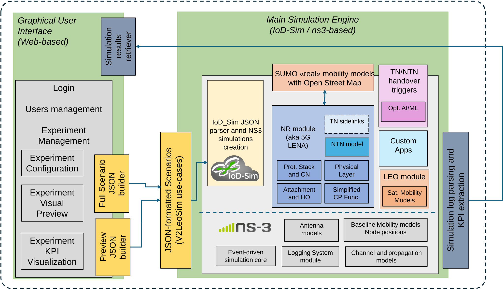

<p align="center">
  
</p>

<h1 align="center">V2LeoSim</h1>

<p align="center">
  <b>Vehicle-to-LEO Simulator</b><br>
  A system-level simulator for 5G V2X services over integrated Terrestrial/Non-Terrestrial (LEO) Networks<br>
  <a href="https://resilience.esa.int/archives/projects/v2leosim"><b>Project website</b></a>
</p>

> [!WARNING]
> **V2LeoSim is under active development.** Features, APIs, JSON scenario
> formats and documentation may change at any time without notice. It is not
> yet ready for production use.

---

## Table of Contents

- [Overview](#overview)
- [Architecture](#architecture)
- [Getting Started](#getting-started)
  - [Clone the repository](#clone-the-repository)
  - [Configure the repository](#configure-the-repository)
- [Development Workflow](#development-workflow)
- [Roadmap](#roadmap)
- [Citation](#citation)
- [Acknowledgements](#acknowledgements)
- [License](#license)

---

## Overview

**V2LeoSim** is an end-to-end, discrete-event simulator designed to evaluate
**Vehicle-to-Everything (V2X)** services delivered through hybrid
**Terrestrial (TN)** and **Non-Terrestrial (NTN)** 5G networks, with a focus on
**Low Earth Orbit (LEO)** satellite constellations.

More information about the project is available on the
[V2LeoSim project page](https://resilience.esa.int/archives/projects/v2leosim)
and in the [SmartNets 2026 paper](https://ieeexplore.ieee.org/document/11604789)
(see [Citation](#citation)).

The simulator is built on top of [IoD_Sim](https://github.com/telematics-lab/IoD_Sim),
which in turn wraps [ns-3](https://www.nsnam.org/), and extends it with:

- 🛰️ **LEO constellation modelling**: function-based and TLE-based orbit models, multi-beam satellite front-end, Inter-Satellite Links (ISL) for ground offloading
- 📡 **5G NR for TN and NTN** through [5G-LENA](https://5g-lena.cttc.es/)
- 🔁 **Advanced TN/NTN handover management**: baseline and AI/ML-driven policies
- 🚗 **Realistic vehicular mobility** via [SUMO](https://eclipse.dev/sumo/) and [OpenStreetMap](https://www.openstreetmap.org/) road topologies
- 📱 **V2X application models**: eCall (VoIP), HD Mapping, Cooperative Collision Avoidance and Tele-Operated Driving
- 🖥️ **Web-based GUI** for experiment configuration, scenario preview, run monitoring and KPI visualization

---

## Architecture

<p align="center">
  
</p>

The system has two main blocks that exchange data through **JSON scenarios**:

| Block | Role |
| --- | --- |
| **Graphical User Interface** (`gui/`) | Web-based front-end for login, user and experiment management, experiment configuration, visual preview and KPI visualization. A *Full Scenario JSON Builder* and a *Preview JSON Builder* turn user input into IoD_Sim-compatible scenarios. A *Simulation Results Retriever* collects the outputs. |
| **Main Simulation Engine** (`core/`) | IoD_Sim and ns-3: the JSON parser and simulation builder, the event-driven core, NR (TN/NTN), LEO mobility, channel/propagation, antenna, application, mobility (SUMO/OSM) and logging modules, plus the log parsing and KPI extraction pipeline. |
| **Handover module** (`ho-module/`) | TN/NTN handover models and evaluations. They are studied here first and then integrated into the simulation engine. |
| **Vehicular mobility** (`sumo/`) | SUMO/OpenStreetMap pipeline that produces realistic vehicle traces for the simulation engine. |

---

## Getting Started

> [!NOTE]
> V2LeoSim targets **Linux** (Debian/Ubuntu, Fedora, Arch Linux). On macOS or
> Windows, use [Docker](https://www.docker.com/) or
> [WSL](https://learn.microsoft.com/windows/wsl/about).

### Clone the repository

This repository uses **git submodules**. Clone it together with its submodules:

```bash
git clone --recurse-submodules https://github.com/telematics-lab/V2LeoSim.git
cd V2LeoSim
```

If you already cloned it without `--recurse-submodules`:

```bash
git submodule update --init --recursive
```

### Configure the repository

> [!IMPORTANT]
> 🚧 **Work in progress.** This section will contain the steps to configure the
> whole V2LeoSim stack (core, GUI and handover module).

---

## Development Workflow

Development follows a **Gitflow-like** branching model:

- **`main`**: latest stable, tagged release. Each merge is a formal release.
- **`develop`**: integration branch for ongoing work.
- **`feature/*`**: one branch per feature, merged into `develop` through a pull request.
- **`release/*`**: stabilization and bug-fixing before a release.

---

## Roadmap

V2LeoSim is developed through **incremental releases**. The simulation core,
the GUI and the Enhanced Handover module each evolve in their own release
stream, and the streams meet at integration checkpoints. **Rel. 3** is the
final, fully integrated V2LeoSim simulator.

| Release | Simulation core (`core/`) | GUI (`gui/`) | Enhanced HO (`ho-module/`) |
| :---: | --- | --- | --- |
| **Rel. 0**<br><sub>Initial baseline</sub> | • JSON configuration for preview and full runs<br>• Small/fixed LEO constellations (parametric or TLE, no ISL)<br>• Simple TN/NTN 5G configurations and baseline NTN adaptations<br>• Few vehicles with simple or fixed-trace mobility<br>• Baseline handover, simple CBR applications<br>• Basic logging and text-based KPI extraction | • Scenario and User Story preview<br>• Selection of static User Stories<br>• Visualization of fixed parameters<br>• Simulation launch | • Standalone decision testing on synthetic data<br>• Validation of I/O data structures and inference process |
| **Rel. 1**<br><sub>First integration</sub> | • Handover calibration with realistic models and multiple HO modes<br>• Full NTN adaptations and 5G-LENA updates towards 5GS Standalone<br>• Medium-scale simulations<br>• SUMO mobility on real maps and custom mobility models<br>• Initial set of V2X applications with KPI tracing<br>• Data export for GUI preview and playback<br>• Inter-Satellite Links (ISL) | • User/admin login<br>• User Story templates with preview<br>• Custom User Stories with editable parameters<br>• Closed-loop execution with job status<br>• SUMO-based and predefined mobility (e.g., cross-border)<br>• Experiment history and first KPI graphs/tables | • ns-3 ⇄ Python state-data exchange<br>• First integrated baseline decision<br>• Logging of exchanged information and decision timing |
| **Rel. 2**<br><sub>Complete User Story support</sub> | • Full-scale simulations as required by the User Stories<br>• All V2X applications of interest with KPI tracing<br>• Complete logging, including 3D playback data<br>• Pre-validation against the literature and benchmarks | • Full experiment management (view/delete)<br>• Complete KPI viewer<br>• 3D experiment player based on [CesiumJS](https://cesium.com/platform/cesiumjs/) | • Location-based Conditional Handover (LCHO)<br>• AI/ML-assisted handover decision<br>• Dedicated KPIs for comparison with baseline strategies |
| **Rel. 3**<br><sub>Final integrated baseline</sub> | • Final component integration and interface adjustments<br>• Stress testing, performance and scalability optimization<br>• Regression testing of the complete software chain | • Integration adjustments<br>• Scalability optimization and bug fixing | • Integration into the final simulator baseline<br>• End-to-end validation of the enhanced HO strategies |

**Rel. 3** is the reference version of the software for the final verification
and validation campaign.

---

## Citation

If you use V2LeoSim in your research, please cite:

> G. Bembo, V. Eramo, T. Fiori, F. G. Lavacca, D. Pugliese, G. Sciddurlo,
> D. Striccoli and F. Zampognaro, "V2LeoSim: A turnkey simulator for 5G V2X NTN
> scenarios evaluation," *2026 International Conference on Smart Applications,
> Communications and Networking (SmartNets)*, Rome, Italy, 2026, pp. 1-6,
> doi: [10.1109/SmartNets69662.2026.11604789](https://ieeexplore.ieee.org/document/11604789).

---

## Acknowledgements

The work described here is supported by **ESA Contract N.: 4000147983/25/NL/GM/fm**,
[V2LeoSim project](https://resilience.esa.int/archives/projects/v2leosim), within
the ESA ARTES 4.0 Strategic Programme Line 5G/6G.

<sub>Responsibility for the content resides in the author or organisation that
prepared it and can in no way be taken to reflect the official opinion of ESA.</sub>

---

## License

This program is free software; you can redistribute it and/or modify
it under the terms of the GNU General Public License as published by
the Free Software Foundation; either version 2 of the License, or
(at your option) any later version.

This program is distributed in the hope that it will be useful,
but WITHOUT ANY WARRANTY; without even the implied warranty of
MERCHANTABILITY or FITNESS FOR A PARTICULAR PURPOSE. See the
[GNU General Public License v2](LICENSE) for more details.

The `core` submodule ([IoD_Sim](https://github.com/telematics-lab/IoD_Sim)) is
also released under the [GNU General Public License v2](core/LICENSE).
